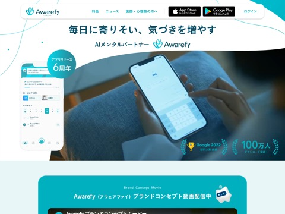
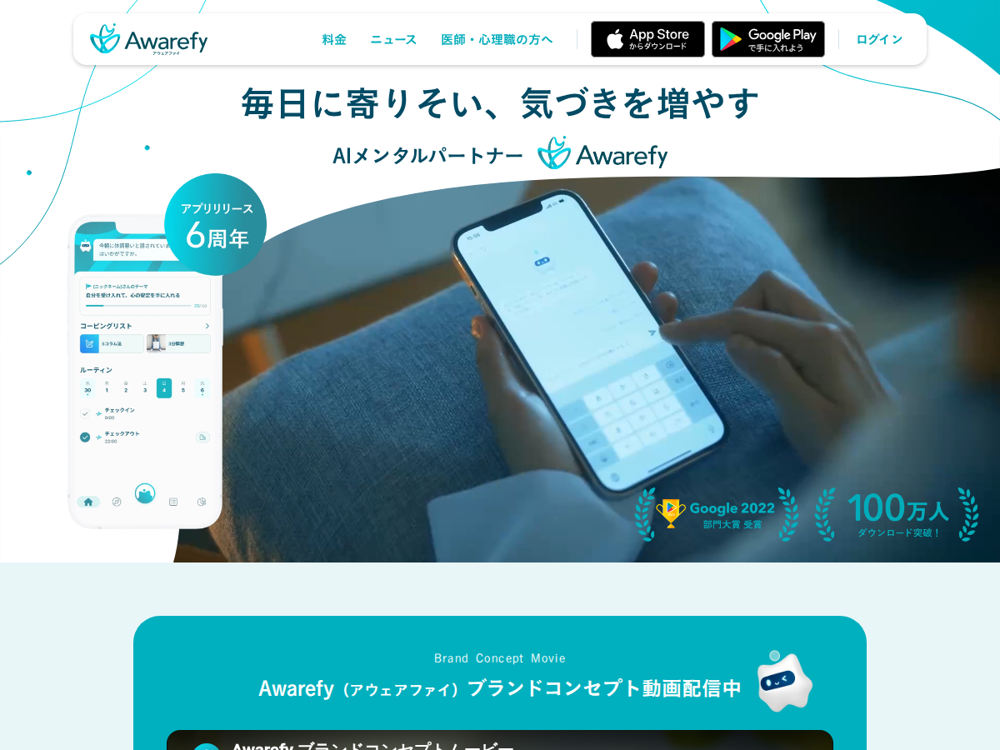
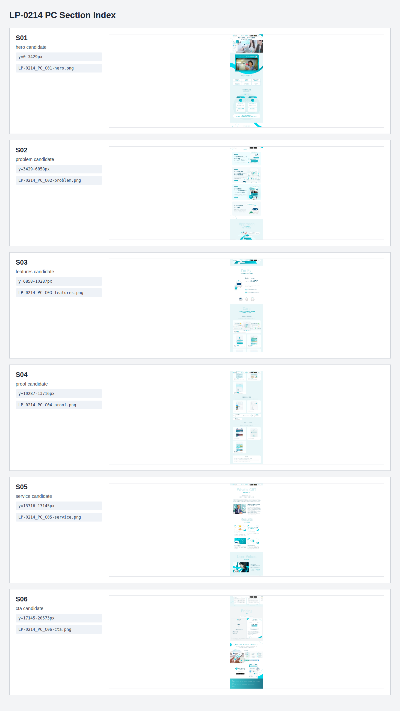
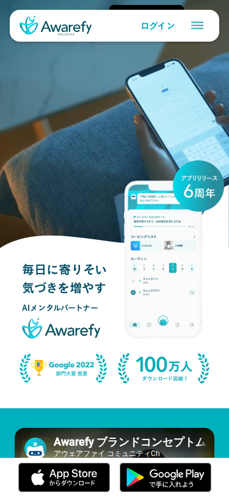
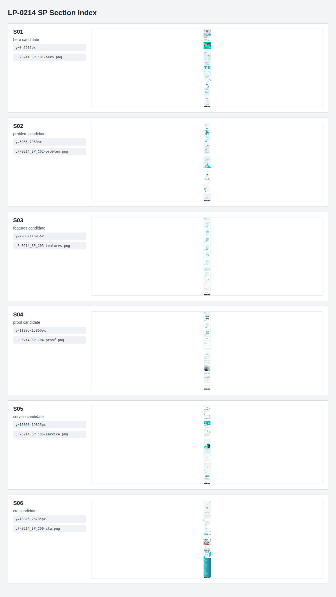

# LP-0214｜Awarefy｜LP分析（統一28章 v4.0）

| ヘッダーメタ | 内容 |
| --- | --- |
| サムネイル | 上の画像（PC First View） |
| LP番号 | LP-0214（既存のライブラリー番号を維持。既存のNotionページは軽量分析のみ。章28参照。DISの9軸の分析は無い） |
| ステータス | 完成（v1.0。ローカルのみ）。PC・SPともに全18Sectionを画像で確認済み。動画・動き・リンク先・現行の料金は未確認 |
| オファーカテゴリ | アプリのダウンロード（無料プランあり）／有料プラン（年間・月間。7日間の無料トライアル）。価格の表示あり（章9） |
| コピータイプ | 共感・安心訴求（「寄りそい」「気づき」）／機能・仕組みの説明（AI×心理学・認知行動療法）／実績・第三者評価（受賞・100万人・★4.4）／価格あり |
| 業種カテゴリ | デザイン・アプリ・システム（メンタルケアアプリ。LPアーカイブの分類。味のタグは「信頼・安心系」） |
| 商材 | スマートフォンアプリ「Awarefy」（AIメンタルパートナー「ファイさん」。AIチャット・AIじぶん分析・コーピング・ルーティン・音声ガイド・学習コース。iOS・Android） |
| 主要CV | アプリのダウンロード（App Store／Google Play）。ボタンは冒頭のナビと終盤（Section 17）にあり、中盤の本文内にはない。遷移先は未確認 |
| URL | https://www.awarefy.com/app（取得URL。現行の実ページは未確認） |
| Archive URL | https://rdlp.jp/archives/otherdesign/lp/229261 |
| PC・SP | PC 1200×20,573px／SP 375×23,785px（GitHub Actions版。章1・章23参照） |
| 権利区分 | reference_only／rights_unknown |
| 取得日 | 2026-09-27（画像ファイルの更新日時による。Dropboxの取得記録ファイルにある別の取得版の撮影は 2026-09-26。ページの公開時点ではない） |
| 版番号・更新日 | v1.0・2026-11-14 |
| 検証状態 | PC・SPとも画像で全18Section確認済み。動画の中身・動き・リンク先・実機での表示・現行の料金は未確認 |
| Scout元 | LPアーカイブ（アーカイブ候補の取込み。LP-0214〜LP-0222のうちの1件） |
| 形式基準 | 統一28章 v4.0（章順固定。実行・重複防止記録は章28、更新履歴は章29） |

---

## 1. 基本情報

| 項目 | 内容 | 根拠・確信度 |
| --- | --- | --- |
| LP-ID | LP-0214 | [事実] 既存のライブラリー番号を維持（新しい番号なし。章28）、高 |
| 対応するDIS | なし（DISの9軸の分析は無い） | [事実] 本LPはDISの9軸の対象外。評価は章5・章21のヒューリスティックのみ |
| 正式名称 | Awarefy（アウェアファイ）アプリ紹介LP。「毎日に寄りそい、気づきを増やす AIメンタルパートナー Awarefy」 | [画像読取り] Section 01、高 |
| ブランド / 運営会社 | Awarefy／株式会社Awarefy（アーカイブの記載）。フッターの表記は『© 2024 Awarefy Inc.』、リンクに『運営会社』あり | [画像読取り] Section 18、高。アーカイブの会社名はmetadata.json |
| URL | https://www.awarefy.com/app | [事実] metadata.json の captureUrl。実ページは未確認 |
| Archive URL | https://rdlp.jp/archives/otherdesign/lp/229261 | [事実] metadata.json、高 |
| LP種別 / 業種 | アプリ紹介LP（縦長の1ページ。機能・根拠・実績・料金・DLを順に見せる）／メンタルケアアプリ | [画像読取り] 高 |
| 商材 | AIメンタルパートナーのアプリ（無料プラン／AIパートナープラン） | [画像読取り] Section 15、高 |
| 主コンバージョン | アプリのダウンロード（App Store・Google Play のバッジ型ボタン） | [画像読取り] Section 01・17、高。遷移先は[未確認] |
| 価格 | AIパートナープラン（年間）月額 約¥1,583（税込）／12ヶ月分 一括¥19,000（税込）。フリープランは無料。月間プランの価格は画像に出ていない（タブのみ） | [画像読取り] Section 15、高。月間は[未確認] |
| 期間・日付 | 最新情報の3件（2025-04-30／2025-07-08／2026-04-13）。『App Store評価 ★4.4（レビュー総数4,713件・2025/4/23時点）』 | [画像読取り] Section 11・14、高 |
| 使った取得版 | GitHub Actions版（LP-0214_GitHubActions_PC_* ／ GitHubActions_SP_*）。PC・SPともに同じ取得版で揃えた。画像フォルダ内では `LP-0214_PC_full.png` などの名前に直して置いた（章23） | [事実] 理由は下記 |
| 取得版を選んだ理由 | 名前に GitHubActions／Mac が付かない版（PC 1200×20,357／SP 375×23,385）は、遅延読み込みの画像が表示されず、STEP・Approach・機能カードなどの画像部分が空白になる（画像で確認）。GitHub Actions版（PC 1200×20,573／SP 375×23,785）は、空白がなく、全体が表示される。Mac_*_lazyfixed とGitHub Actions版は、高さが同じ（PC 20,573／SP 23,785） | [画像読取り] 高。ファイルの中身の突合は、高さの一致のみ |
| PC/SP | PC 1200×20,573px／SP 375×23,785px | [事実] 画像実測 |
| 画像の出どころ | 実ページのスクリーンショット（captureMode: target_site）。LPアーカイブの掲載画像ではない | [事実] metadata.json・capture_summary.json |
| 検証状態 | 完成（v1.0）。未確認項目は章17 | 章28参照 |

---

## 2. LP全体マップ（実画像）

### PC Full Page

- 原本: 画像フォルダ内 `LP-0214_PC_full.png`（元は Dropbox の `LP-0214_GitHubActions_PC_full.png`）
- 寸法: 1200×20,573px（16,383pxで切れていない。下端はフッターの『© 2024 Awarefy Inc.』まで写っている）
- 版・取得日時: GitHub Actions版／2026-09-27（画像ファイルの更新日時。撮影の時刻・環境は取得記録ファイルに無く未確認）
- 用途: 分析・参照用
- 用途制限: 第三者配布・広告転用は、権利確認まで不可（人物写真・受賞ロゴ・アプリ画面・キャラクターを含む）

### PC First View

- 原本: `LP-0214_PC_first_view.png`／1200×900px（元は GitHubActions_PC_first_view.png）
- 版・取得日時: 上に同じ
- 用途: 1画面目の確認。用途制限: 同上
- 注記: 最上部に白い角丸のナビ（ロゴ・料金・ニュース・医師・心理職の方へ・App Store・Google Play・ログイン）。写真の下端は約675pxで、画像900pxの下側は、Section 02（ブランドコンセプト動画）の水色の背景に入る

### PC Section一覧（Contact Sheet）

- 原本: `LP-0214_PC_sections.png`／1200×2128px（機械的な6分割の一覧。意味単位の18Sectionとは一致しない）
- 6分割の切り出し: `images/LP-0214_PC_C01-hero.png`〜`LP-0214_PC_C06-cta.png`（各約3,429px。章3の対応）

### SP Full Page

- 原本: `LP-0214_SP_full.png`（元は GitHubActions_SP_full.png）
- 寸法: 375×23,785px
- 版・取得日時: GitHub Actions版／2026-09-27（実機の端末・ブラウザは未確認）
- 用途・用途制限: PCに同じ

### SP First View

- 原本: `LP-0214_SP_first_view.png`／375×812px
- 注記: 最上部に白い角丸のバー（ロゴ・ログイン・ハンバーガーメニュー）。PCと違い、FVの背景は、女性2人が紙を見る写真（後述）

### SP Section一覧

- 原本: `LP-0214_SP_sections.png`／1200×2128px（機械的な6分割の一覧）
- 6分割の切り出し: `images/LP-0214_SP_C01-hero.png`〜`LP-0214_SP_C06-cta.png`（各約3,960px）

---

## 3. Section位置索引

PC画像（1200×20,573px）・SP画像（375×23,785px）の実測座標。Full Pageを約1,500px（PC）・1,800px（SP）で区切って目視し、背景色・見出しの切れ目から決めた。±数十pxの誤差を含む。意味単位でSectionを分けたため、機械的な6分割（C01〜C06）とは境界が一致しない。

| Section | PC y範囲(px) | SP y範囲(px) | 役割 / 主要内容 | 対応画像 |
| --- | --- | --- | --- | --- |
| 01 | 0–675 | 0–667 | FV：見出し『毎日に寄りそい、気づきを増やす』＋AIメンタルパートナー Awarefy＋受賞・100万人 | `LP-0214_PC_C01-hero.png` / `LP-0214_SP_C01-hero.png` |
| 02 | 675–1,470 | 667–1,033 | ブランドコンセプト動画（YouTubeの埋め込み風のサムネイル） | `LP-0214_PC_C01-hero.png` / `LP-0214_SP_C01-hero.png` |
| 03 | 1,470–1,950 | 1,033–1,650 | 『こんなことはありませんか？』：悩みカード6枚 | `LP-0214_PC_C01-hero.png` / `LP-0214_SP_C01-hero.png` |
| 04 | 1,950–3,260 | 1,650–2,567 | 『AI×心理学ではじめる自己理解と心のケア』：AIと心理学の4カード＋結論 | `LP-0214_PC_C01-hero.png`・`C02` / `LP-0214_SP_C01-hero.png`・`C02` |
| 05 | 3,260–6,095 | 2,567–5,640 | 『あなたの強みや心のサイン』：STEP 01〜03＋『気づきから始まる小さな変化』 | `LP-0214_PC_C02-problem.png`・`C03` / `LP-0214_SP_C01-hero.png`〜`C03` |
| 06 | 6,095–7,108 | 5,640–6,243 | Approach：山の道のイラスト（4つの段階） | `LP-0214_PC_C03-features.png` / `LP-0214_SP_C02-problem.png`・`C03` |
| 07 | 7,108–8,528 | 6,243–7,540 | I'm Fy：AIパートナー「ファイさん」の紹介（性格・特技・たからもの） | `LP-0214_PC_C03-features.png`・`C04` / `LP-0214_SP_C03-features.png` |
| 08 | 8,528–11,150 | 7,540–10,440 | Care：自己理解につながる機能（AIじぶん分析・チャット・ノート・コメント・レコメンド・コーチング） | `LP-0214_PC_C04-proof.png`・`C05` / `LP-0214_SP_C03-features.png`・`C04` |
| 09 | 11,150–12,120 | 10,440–11,780 | 習慣化につながる機能（コーピング・ルーティン・ほか4項目） | `LP-0214_PC_C05-service.png` / `LP-0214_SP_C04-proof.png`・`C05` |
| 10 | 12,120–13,350 | 11,780–13,150 | 学び・実践につながる機能（音声ガイド・こころの状態測定・学習コース） | `LP-0214_PC_C05-service.png`・`C06` / `LP-0214_SP_C05-service.png` |
| 11 | 13,350–13,785 | 13,150–13,837 | 最新情報（日付つきの3件） | `LP-0214_PC_C06-cta.png` / `LP-0214_SP_C05-service.png`・`C06` |
| 12 | 13,785–14,950 | 13,837–15,590 | What's CBT：認知行動療法の説明＋早稲田大学との共同研究 | `LP-0214_PC_C05-service.png`・`C06` / `LP-0214_SP_C05-service.png`・`C06` |
| 13 | 14,950–16,253 | 15,590–17,525 | Results：これまでの実績（4件） | `LP-0214_PC_C06-cta.png` / `LP-0214_SP_C06-cta.png` |
| 14 | 16,253–17,540 | 17,525–18,843 | User Voices：ユーザーの声（★4.4・レビューのカルーセル） | `LP-0214_PC_C06-cta.png` / `LP-0214_SP_C06-cta.png` |
| 15 | 17,540–18,825 | 18,843–20,770 | Pricing：料金（フリープラン／AIパートナープラン） | `LP-0214_PC_C06-cta.png` / `LP-0214_SP_C06-cta.png` |
| 16 | 18,825–19,634 | 20,770–22,099 | 『気づきたい人にも…』：分析結果のイメージ＋おすすめのセルフケア | `LP-0214_PC_C06-cta.png` / `LP-0214_SP_C06-cta.png` |
| 17 | 19,634–20,200 | 22,099–22,755 | 最終CTA：ロゴ＋コピー＋ストアバッジ＋アプリ画面 | `LP-0214_PC_C06-cta.png` / `LP-0214_SP_C06-cta.png` |
| 18 | 20,200–20,573 | 22,755–23,785 | フッター：Links・Support・© 2024 Awarefy Inc. | `LP-0214_PC_C06-cta.png` / `LP-0214_SP_C06-cta.png` |

---

## 4. LP分析とパーツ管理の役割分担

| 区分 | 内容 |
| --- | --- |
| LP分析の知見（この文書） | 構成・情報の順序・見出しの型・配色・訴求・PC/SPの組み替え・未確認事項 |
| パーツ台帳候補 | 白い角丸のナビ＋ストアバッジ／悩みカード6枚（2行テキスト：状況＋望む状態）／AIと心理学の2カラム＋結論の帯／STEPカード（ラベル・見出し・本文・タグ・右にアプリ画面）／山の道のイラストの段階表／キャラクター紹介の表（性格・特技・たからもの）／機能カード（画面画像＋名称＋AI機能バッジ＋1行説明）／実績カード（画像＋見出し＋本文）／レビューのカルーセル／料金の2カード（年間・月間のタブ）／グラデーションのフッター |
| rights_excluded（転用しない） | ロゴ・ブランド名（Awarefy）、キャラクター「ファイさん」、アプリの画面画像、人物写真（女性・研究者）、受賞・実績のロゴ、ブランドコンセプト動画、ユーザーレビューの文、早稲田大学・研究者の名前、コピー（『毎日に寄りそい、気づきを増やす』ほか） |
| reference_only（参照のみ） | 情報の順序、背景の交互（水色・白）、見出しの型（淡い大きな英字＋日本語の見出し）、カードの構造、PC横並びをSPで縦に組み替える方法、料金カードの構成 |
| 未切出候補 | 淡い大きな英字の見出し（Approach／I'm Fy／Care／What's CBT／Results／User Voices／Pricing）／AI機能バッジ／月額換算の価格の見せ方／ストアバッジ |

---

## 5. エグゼクティブサマリー

- [画像読取り・高] 目的は、メンタルケアアプリ「Awarefy」を、強い悩みの煽りではなく『毎日に寄りそい、気づきを増やす』という日常の言葉で紹介し、App Store／Google Play からのダウンロード（無料開始、有料プランへの案内）へつなげること。
- [画像読取り・高] 構成は、FV（見出し・受賞・100万人）→ブランドコンセプト動画→悩みカード6枚→AI×心理学の仕組み→STEP 01〜03→Approach（山の道）→AIパートナー「ファイさん」→機能（自己理解・習慣化・学び）→最新情報→認知行動療法・共同研究→実績→ユーザーの声→料金→分析結果のイメージ→最終CTA→フッター。18セクションを、水色の背景と白の交互で見分けさせている。
- [画像読取り・高] 強み：①FVで受賞（Google 2022 部門大賞）・100万人ダウンロード・6周年を見せ、領域に必要な安心感を先に置く。②淡い水色・白・濃い青緑（#004B64）で統一し、キャラクターの丸いやさしい形が一貫する。③機能を3分類（自己理解／習慣化／学び・実践）に整理し、画面画像で見せる。④料金を月額換算（約¥1,583）で示し、7日間の無料トライアルも明記する。
- [画像読取り・高] 最大の弱み：ダウンロードのボタンが、ナビ（FV）と終盤（Section 17）にしかなく、機能・実績・料金の本文内にない。料金のカード内にも、申込み・DLのボタンが見当たらない。
- [画像読取り・中] もう1つの弱み：本文の小さな文字が淡い灰色で、背景の水色の上では読みにくく見える（章12）。実績の数字の整合（FVは『アプリリリース6周年』、実績カードは『誕生5周年』、フッターは『© 2024』）にずれがあり、掲載時期の違いか訂正漏れかは判別できない。
- 総合評価: **82/100**（ヒューリスティック。静止画像のみ。DISの9軸の評価ではなく、このLPにはDISの9軸の評価は無い。混ぜない）。内訳：構造の明快さ 18/20、ビジュアルの一貫性 18/20、訴求・コピー 12/15、信頼・証拠 13/15、行動導線 11/15、可読性 10/15。合計＝18＋18＋12＋13＋11＋10＝82。
- [未確認] 動画の中身・再生の挙動、各リンク先、レビューのカルーセルの総数、月間プランの価格、現行の料金・実績の数字は、静止画像では確認できない（章17）。

---

## 6. 想定ターゲット・具体的ペルソナ・購入心理

- 一次ターゲット: [推定・中] 日々のストレス・感情の波・モヤモヤに悩み、受診や相談の前に、まず自分で整えたい成人。悩みカード『穏やかに暮らしたい／楽になりたい／自信を持ちたい／自分らしく過ごしたい／上手に対処したい／整理したい』が、その層の言葉に見える。
- 二次ターゲット: [推定・低] 医師・心理職など専門家（ナビに『医師・心理職の方へ』があるが、遷移先は未確認）。
- 具体ペルソナ: [推定・低] 20〜40代の会社員。仕事の疲れで気分が揺れ、スマホでAIに話しながら、自分の傾向を知りたい。有料は、無料の範囲を試してから判断する。
- 状況: [画像読取り] 夜にソファでスマホを触る女性（FV）、動画のサムネイル（スマホを持つ女性）。静かで落ち着いた場面。
- 課題: [画像読取り] 『感情の波に振り回されず』『日々のストレスを溜め込まず』『モヤモヤを受け止めて』。病名ではなく、日常の感情の整理が課題として置かれる。
- 欲求: [画像読取り] 自己理解、気づき、自分に合うセルフケア、習慣化、継続の理由。
- 不安: [推定] 医療行為か否か、AIとの会話の安全性、料金、個人情報。画像内では、『公認心理師が監修』『早稲田大学との共同研究』『Google Play受賞』が、安心の根拠として置かれる。
- 比較対象: [推定・低] 他のメンタルケア・瞑想・日記アプリ。競合名は画像にない。
- 流入時心理: [推定] アプリの広告や検索から来て、アプリの内容・信頼・料金を一度に確認したい。
- Section心理遷移: S01 安心・共感→S02 興味（動画）→S03 自分ごと化→S04 仕組みの理解→S05 利用イメージ→S06 変化の予感→S07 親近感（キャラクター）→S08〜S10 機能の幅の納得→S11 更新の確認→S12 根拠への信頼→S13 実績の確認→S14 他の人の声→S15 費用の判断→S16 利用後のイメージ→S17 行動→S18 出口。
- 最終行動: [画像読取り] App Store／Google Play のバッジ（S01のナビ・S17）。料金のカードに、独立のボタンは見当たらない。

---

## 7. 構成骨格・情報優先順位・視線誘導

- 骨格: つかみ（FV・受賞）→共感（動画・悩みカード）→解決の仕組み（AI×心理学・STEP・Approach・ファイさん）→機能（3分類）→根拠（CBT・共同研究・実績・声）→価格→再提示（分析結果・最終CTA）→出口。
- 背景の交互：水色（S02・S03・S04・S06・S08〜S11・S14）と、白（S01・S05・S07・S12・S13・S17）と、薄い灰（S15）。淡い大きな英字（Approach／I'm Fy／Care／What's CBT／Results／User Voices／Pricing）が、章の見出しの役割を担う。
- 視線: FVは、中央の見出し→『AIメンタルパートナー Awarefy』→左のアプリ画面・右の人物写真→右下の受賞・100万人、と下へ流れる[画像読取り・中]。以降は、中央揃えの見出し→カードの縦の流れ。STEPは左に文・右に画像のZ型。
- 情報優先順位: [画像読取り] ブランドの約束（寄りそい・気づき）> 実績（受賞・100万人）> 仕組み（AI×心理学）> 機能 > 根拠 > 声 > 料金。
- 離脱リスク: [画像読取り・中] ボタンが本文内にない／SPが約23,785pxと長い（機能の3分類だけで約5,600px）／料金（S15）がページの終盤（PC約17,540px以降）にある／本文の文字が淡い。
- 視線の終点: 最終CTAのストアバッジ（S17）と、フッターのリンク群（S18）。

---

## 8. 全Section分析（固定15項目）

### Section 01｜FV（見出し・AIメンタルパートナー・受賞・100万人）

1. Section番号・位置: 01／PC 0–675px／SP 0–667px
2. 役割: 最初の画面で、ブランドの約束（寄りそい・気づき）と、受賞・ダウンロード数の実績を見せ、安心感を作る導入。
3. 見出し・主要コピー: 『毎日に寄りそい、気づきを増やす』（濃い青緑の太字）。サブ『AIメンタルパートナー』＋ロゴ『Awarefy（アウェアファイ）』。バッジ『アプリリリース 6周年』。実績『Google 2022 部門大賞 受賞』『100万人 ダウンロード突破！』。ナビ『料金／ニュース／医師・心理職の方へ』『ログイン』。
4. 価格・オファー: なし（ナビの『料金』は、価格の先頭の導線）。
5. CTA: ナビのバッジ型ボタン『App Store からダウンロード』『Google Play で手に入れよう』（黒地）。『ログイン』。SPはハンバーガーメニューと『ログイン』。
6. バッジ・ラベル: 青緑のグラデーションの円『アプリリリース 6周年』。月桂樹の枠の実績2つ（Google 2022 受賞／100万人）。
7. アイコン: ロゴマーク（芽のような形）。ストアのバッジのアイコン。
8. カード・表・FAQ: なし（PCは、白い角丸のナビのバー）。アプリ画面が、カード状に左に置かれる。
9. 装飾: 白地に、青緑の細い曲線と点。写真との境は、大きな弧。右上に青緑の太い弧。
10. 画像・人物・商品配置: PCは、左にアプリのホーム画面、右にソファでスマホを触る人の写真（手元・暗めの色調）。SPは、女性2人が紙を見る写真が背景で、下にアプリ画面（右）と見出し（左）、その下に月桂樹の実績。
11. 訴求意図・購入心理への作用: 悩みを煽らず、日常の言葉で入る。受賞・100万人・6周年をFVに置き、医療に近い領域の不安を下げる。ストアのバッジを最上部に置き、すぐ入手できると示す。
12. PC/SP差: PCは中央揃えの見出しが写真の上に出る。SPは、見出しが左下、写真が背景に変わり、写真の内容がPCと違う（人物2人）。SPでは、バッジ・実績が縦に積まれ、ストアバッジの帯が画面の途中（約750px付近）に出る。
13. 証拠ソース: `LP-0214_PC_first_view.png`／`LP-0214_SP_first_view.png`／`LP-0214_PC_C01-hero.png`／`LP-0214_SP_C01-hero.png`
14. 確信度: 高（文字・実績・配置）。
15. 未確認事項・failure_reason: SPのストアバッジの帯が、追従する固定バーか、撮影時の重なりかは判別不可（約750px付近の表示）／ナビ・ログインのリンク先／写真がPCとSPで違う理由（動画の1コマか別素材か）／『6周年』と実績カードの『5周年』の関係／フォント・正確な寸法。

### Section 02｜ブランドコンセプト動画

1. Section番号・位置: 02／PC 675–1,470px／SP 667–1,033px
2. 役割: ブランドの世界観を、動画で見せる。FV直下で、アプリが使われる場面と、キャラクターへの親しみを作る。
3. 見出し・主要コピー: 『Brand Concept Movie』『Awarefy（アウェアファイ）ブランドコンセプト動画配信中』。動画のタイトル『Awarefy ブランドコンセプトムービー』『アウェアファイ コミュニティCh』。動画内に『COPING LIST／頭を切り替える瞑想／三行日記／課題を深掘るAIコーチング』。
4. 価格・オファー: なし。
5. CTA: 動画の再生ボタン（赤）、『見る YouTube』のボタン。共有のアイコン。
6. バッジ・ラベル: 動画の左上にチャンネルのアイコン。
7. アイコン: キャラクター（右上）。YouTubeの再生・共有。
8. カード・表・FAQ: 濃い青緑の角丸の枠（見出し＋動画のサムネイル）。
9. 装飾: 水色の背景に、鮮やかなシアンの大きな弧。枠の下に、白い弧。
10. 画像・人物・商品配置: 中央に、スマホを持つ女性（微笑む）。左に、浮かぶ3項目のリスト（コーピング）。上に、キャラクター。
11. 訴求意図・購入心理への作用: 文字で説明する前に、表情と空気で『やさしいサービス』と伝える。動画は、押さずに読み進めても支障のない任意の導線。
12. PC/SP差: PCは、枠が中央（幅約880px）で動画が大きい。SPは、枠が全幅で、見出しが動画の下に移る。SPでは、ストアバッジの帯が、動画の上に重なって写る。
13. 証拠ソース: `LP-0214_PC_C01-hero.png`／`LP-0214_SP_C01-hero.png`
14. 確信度: 高（見える文字）／動画の中身は[未確認]。
15. 未確認事項・failure_reason: 動画の長さ・音声・字幕の有無／再生で外部（YouTube）に遷移するか、ページ内で再生するか／サムネイルの映像が、動画の1コマか静止画か／チャンネル名の位置づけ（公式の別チャンネルか）。

### Section 03｜こんなことはありませんか？（悩みカード）

1. Section番号・位置: 03／PC 1,470–1,950px／SP 1,033–1,650px
2. 役割: 利用者の悩みを、望む状態の言葉で並べ、自分ごと化させる共感の導入。
3. 見出し・主要コピー: 『こんなことはありませんか？』。カード6枚（上の小さな文＋下の青緑の強調）：『心の状態を把握して／穏やかに暮らしたい』『思考の癖を知って／楽になりたい』『自分の良いところを見つけて／自信を持ちたい』『感情の波に振り回されず／自分らしく過ごしたい』『日々のストレスを溜め込まず／上手に対処したい』『モヤモヤを受け止めて／整理したい』。
4. 価格・オファー: なし。
5. CTA: なし。
6. バッジ・ラベル: なし。
7. アイコン: なし。
8. カード・表・FAQ: 白い角丸のカード6枚（PCは3×2、SPは2×3）。薄い影。
9. 装飾: 水色の背景。装飾は少ない。
10. 画像・人物・商品配置: 画像なし（文字のみ）。
11. 訴求意図・購入心理への作用: 否定的な症状ではなく、『なりたい状態』の言葉で書き、病気の自覚がない人にも入りやすくしている。強調の色で、望みの部分だけが目に入る。
12. PC/SP差: PCは3列、SPは2列で折り返し、文が3行に伸びるカードが出る（『穏やかに暮らしたい』が1語ずつ折れる）。SPは縦に約1.3倍。
13. 証拠ソース: `LP-0214_PC_C01-hero.png`／`LP-0214_SP_C01-hero.png`
14. 確信度: 高。
15. 未確認事項・failure_reason: カードが押せるか（見た目では判別不可）／強調色（#00ACBB）の文字の実コントラスト（章12に計算値）／SPで文が不自然に折れる箇所の実機での見え方。

### Section 04｜AI×心理学ではじめる自己理解と心のケア

1. Section番号・位置: 04／PC 1,950–3,260px／SP 1,650–2,567px
2. 役割: サービスの仕組みを、『AI』と『心理学』の2本柱の4つの特徴で説明し、結論の帯で価値をまとめる。
3. 見出し・主要コピー: 『AI×心理学ではじめる／自己理解と心のケア』。ロゴ。ラベル『AI』『心理学』。カード：『会話を深く分析／AIがやりとりを通じて、あなたの傾向を読み解き、可視化。』『認知行動療法ベース／認知行動療法に基づく手法や学習コンテンツを搭載。』『最適なケアを提案／分析に合わせて、おすすめのセルフケアを提案。』『心のセルフケア／心のセルフケアの習慣化をサポート。』。結論の帯『気づき・自己理解を促進。／どんな時も、自分の価値観に沿って行動できるようサポート。』
4. 価格・オファー: なし。
5. CTA: なし。
6. バッジ・ラベル: 青緑のグラデーションのラベル『AI』『心理学』。
7. アイコン: 回路のアイコン（AI）、ハート（心理学）、中央の×印、下向きの三角。
8. カード・表・FAQ: 白い大きな角丸のカード4枚（2×2）。下に、結論の帯。
9. 装飾: 同心円状の淡い水色の円を、背景に置く。
10. 画像・人物・商品配置: 画像なし（アイコンとカードのみ）。
11. 訴求意図・購入心理への作用: AIの便利さと、心理学（認知行動療法）の根拠を、左右に並べて対比させ、『AIだけでも心理学だけでもない』と見せる。結論の帯で、価値を1文にまとめる。
12. PC/SP差: PCは、円と2列のカードが中央に収まる。SPは、同じ構成を縮小し、カードの文が細かく折り返す。結論の帯は、SPで3行に増える。
13. 証拠ソース: `LP-0214_PC_C01-hero.png`・`LP-0214_PC_C02-problem.png`／`LP-0214_SP_C01-hero.png`・`LP-0214_SP_C02-problem.png`
14. 確信度: 高。
15. 未確認事項・failure_reason: 『AIが…読み解き』の仕組みの内容（モデル・学習データ・精度）／『認知行動療法に基づく』ことの範囲と、医療行為との線引き／カードの本文が小さく細い灰色（実寸は未計測）／アニメーションの有無。

### Section 05｜あなたの強みや心のサイン（STEP 01〜03）

1. Section番号・位置: 05／PC 3,260–6,095px／SP 2,567–5,640px
2. 役割: アプリの使い方を、3段階（相談→分析→提案）と、気づきの変化で、利用後のイメージとして見せる。
3. 見出し・主要コピー: 小見出し『日々の会話から見える』、見出し『あなたの強みや／心のサイン』。STEP 01『心理AI「ファイさん」に／悩みを相談／あなたのデータがたまる』『ファイさんに悩みを相談すると、あなたの感情の動きや思考のパターンがデータとして蓄積されていきます。』。STEP 02『データを元に分析／あなたの思考パターンや／特性が見えてくる』＋『#AIじぶん分析』。STEP 03『分析の結果から／ファイさんがあなたに合ったセルフケアを提案』＋『#AIじぶん分析』。4つ目（ラベルなし）『気づきから始まる／小さな変化』『数日話してみるだけでも、きっと驚くほど多くの“じぶん”に気づけるはず。…一歩ずつ、自分を理解していく体験を。』。吹き出し『そのモヤモヤ わたしにお話してくれませんか？』『今のあなたにぴったりなセルフケアをレコメンドします』『あなたの言葉でたくさんのお話を聞かせてください』。バッジ『200種類 以上のラインナップ』。
4. 価格・オファー: なし。
5. CTA: なし。
6. バッジ・ラベル: 『STEP 01／02／03』の青緑のラベル。『#AIじぶん分析』のタグ。円形バッジ『200種類 以上のラインナップ』。
7. アイコン: キャラクター「ファイさん」（虫眼鏡・指示棒を持つ）。木のイラスト。
8. カード・表・FAQ: 大きな角丸のカード4枚（薄い水色と、さらに薄い色の交互）。左に文、右にアプリ画面。
9. 装飾: 白地に、青緑の細い曲線と点、右上の鮮やかな弧。
10. 画像・人物・商品配置: 右に、アプリ画面（チャット／思考パターンの分析／セルフケアの一覧）とキャラクターを重ねる。4つ目は、大きなキャラクターと木。
11. 訴求意図・購入心理への作用: 『相談するだけ』という低い負荷から始め、データがたまり、傾向が見える、という順に変化を見せる。画面を見せ、使い方の想像を助ける。
12. PC/SP差: PCは、左に文・右に画像の横並び（カード幅約1,060px）。SPは、画像が上・文が下の縦積みで、カードの高さが約1.5倍に伸びる。見出しは、SPで折り返しが増える。
13. 証拠ソース: `LP-0214_PC_C02-problem.png`・`LP-0214_PC_C03-features.png`／`LP-0214_SP_C01-hero.png`〜`LP-0214_SP_C03-features.png`
14. 確信度: 高。
15. 未確認事項・failure_reason: STEP 01の『ファイさん』の返答は例示で、実際の応答の質は不明／4つ目のカードにSTEPの番号がない意図／アプリ画面内の文字（小さく判読に不確実さあり）／『200種類以上』の数の根拠と更新／画像のアニメーション。

### Section 06｜Approach（あなたの悩みをサポートするステップ）

1. Section番号・位置: 06／PC 6,095–7,108px／SP 5,640–6,243px
2. 役割: 利用者の変化を、山を登る道のイラストで示し、『何も分からない』から『振り回されることが減ってきた』までの進み方を、1枚で伝える。
3. 見出し・主要コピー: 淡い大きな英字『Approach』、見出し『あなたの悩みを／サポートするステップ』。山の道の吹き出し（下から）『何も分からない』『心理AIに相談』『AIじぶん分析で自分の気持ちを把握できるように』『自分に合ったケアに取り組んでメンタルを振り回されることが減ってきた』。
4. 価格・オファー: なし。
5. CTA: なし。
6. バッジ・ラベル: 道の4つの地点のピン。山頂の赤い旗。
7. アイコン: 位置ピン、旗、電球、雲。キャラクター（山頂と麓）。
8. カード・表・FAQ: 白い吹き出しのラベル4つ（大きさが段階で変わる）。
9. 装飾: 水色の背景に、青緑の山と曲がる白い道。淡い雲。
10. 画像・人物・商品配置: 中央に山のイラスト（幅約1,000px）。山頂にキャラクターと旗。
11. 訴求意図・購入心理への作用: 『何も分からない』という出発点を、やさしい言葉で肯定し、一歩ずつ進む感覚を作る。ゴールは『治る』ではなく『振り回されることが減る』という控えめな約束。
12. PC/SP差: PCは、見出しの下に山が中央で大きく出る。SPは、山を縮小し、吹き出しの文を3行に折り返す。山は、SPで画面幅いっぱいに広がる。
13. 証拠ソース: `LP-0214_PC_C03-features.png`／`LP-0214_SP_C02-problem.png`・`LP-0214_SP_C03-features.png`
14. 確信度: 高。
15. 未確認事項・failure_reason: 『減ってきた』という変化の根拠（調査・事例）が、この図には出ていない／淡い大きな英字の背景との重なりによる見え方（SP）／イラストの動きの有無。

### Section 07｜I'm Fy（AIパートナー「ファイさん」の紹介）

1. Section番号・位置: 07／PC 7,108–8,528px／SP 6,243–7,540px
2. 役割: AIキャラクター「ファイさん」の人格・得意なことを紹介し、AIチャットへの親しみと安心を作る。
3. 見出し・主要コピー: 淡い大きな英字『I'm Fy』、『あなたの毎日に寄り添う心理AI』。ラベル『AIパートナー』。見出し『いつでも、どこでも／「ファイさん」があなたの／メンタルケアをサポート』。本文『AIチャット機能を搭載し、いつでも、どこでも、「Fy(ファイ)さん」が話相手になってくれます。ファイさんは、気づきのしずくが集まってできた心やさしいAI。…「気づき」をさらに促進します。』。表：『性格｜穏やかでとてもやさしい／いつもみんなの心の選択肢が増えることを考えている』『特技｜相手の話をじっくり聞くこと』『たからもの｜アウェアファイを通じて聞かせてもらったみんなのありのままの気持ち』。
4. 価格・オファー: なし。
5. CTA: なし。
6. バッジ・ラベル: 青緑の楕円ラベル『性格』『特技』『たからもの』。
7. アイコン: なし（キャラクターの3方向の姿）。
8. カード・表・FAQ: ラベル＋説明の3行の表（罫線で区切る）。
9. 装飾: 白地。キャラクターの下に、薄い影。
10. 画像・人物・商品配置: PCは、左に大きなキャラクターとスマホ画面、右に文。下に、キャラクターの3つの姿（正面・横・背面）。SPは、縦積み。
11. 訴求意図・購入心理への作用: 『AI』を、機械ではなく、聞き役の存在として見せる。プロフィールの形式で、人格を具体にする。
12. PC/SP差: PCは、2カラムで、見出しが右。SPは、キャラクター→見出し→本文→表の縦積みで、見出しが画面幅で4行に折れる。
13. 証拠ソース: `LP-0214_PC_C03-features.png`・`LP-0214_PC_C04-proof.png`／`LP-0214_SP_C03-features.png`
14. 確信度: 高。
15. 未確認事項・failure_reason: キャラクターのアニメーション・音声／『Fy』の呼び方と表記の揺れ（ファイさん／Fy）の使い分け／スマホ画面の中の小さな文字（判読に不確実さあり）。

### Section 08｜Care：自己理解につながる機能

1. Section番号・位置: 08／PC 8,528–11,150px／SP 7,540–10,440px
2. 役割: 『メンタルケアに必要なあらゆる機能』の1分類目として、AIを使った自己理解の機能6つを、画面画像つきで示す。
3. 見出し・主要コピー: 淡い大きな英字『Care』、『メンタルケアに必要なあらゆる機能を搭載／心の健康を、これ一つで。』。小見出し『自己理解につながる機能』『日々の記録やAIとの対話を分析し、あなたの心の状態や思考のパターンを見える化。心理学に基づいたコメントを通じて、自分で内省する以上の気づきをもたらし、自己理解をサポートします。』。機能：『AIじぶん分析 ［AI機能］／話した内容から、あなたの強みや思考パターンなどを読み解き可視化。』『AIチャット／心理学に基づいた応対で、言葉にならない気持ちを優しく受け止めて一緒に整理』『AIノート／認知行動療法に基づくフレームワークで思考や感情を整理し、視点を広げるきっかけに』『AIコメント／客観的なアドバイスで、気づきや「次の一歩」のヒントを得る』『AIレコメンド／対話の中で、今のあなたにおすすめな対処法を提案』『AIコーチング／会話方式でコーチングを実践し、悩みの解決策を探す』。
4. 価格・オファー: なし。
5. CTA: なし（カードに矢印はない）。
6. バッジ・ラベル: 『AI機能』（星のアイコン付きの青緑の楕円）が、各カードの名称の横に付く。分析画面内の浮かぶラベル（『人に気を遣いすぎること』『一度でも失敗すればすべてが台無し／全か無か思考』『自信バッジ』ほか）。
7. アイコン: 分析のチップに、稲妻・棒グラフ・星の形の小さなアイコン。
8. カード・表・FAQ: 大きなカード（AIじぶん分析、全幅）と、2列のカード5枚（画面画像の上、名称・説明が下）。最後の1枚は左に単独。
9. 装飾: 水色の背景に、白いカード。カード内は、画面の画像と、浮かぶ小さなチップ。
10. 画像・人物・商品配置: 各カードの上半分に、アプリ画面の実画面（途中で切れる）。AIじぶん分析は、画面の周りに、ラベルが浮かぶ。
11. 訴求意図・購入心理への作用: 機能名に『AI』を揃え、同じ型のカードで並べて、機能の多さを見せる。画面を見せ、使い方の想像を助ける。『AI機能』のバッジで、AIの機能とそうでない機能を区別する。
12. PC/SP差: PCは、2列のカードで、1枚目が全幅。SPは、全て1列で、各カードの画面が縮小し、画面内の小さな文字が読みにくくなる。SPは、このセクションだけで約2,900pxと長い。
13. 証拠ソース: `LP-0214_PC_C04-proof.png`・`LP-0214_PC_C05-service.png`／`LP-0214_SP_C03-features.png`・`LP-0214_SP_C04-proof.png`
14. 確信度: 高（機能名・説明文）。画面内の文は不確実さあり。
15. 未確認事項・failure_reason: 画面画像が、実際の画面か、デザイン上の例か／各機能の無料・有料の区分（Section 15の機能表と対応が見えない）／カードのリンク・タップの可否／画面内の小さな文字の正確な内容／機能の範囲・利用回数の制限。

### Section 09｜習慣化につながる機能

1. Section番号・位置: 09／PC 11,150–12,120px／SP 10,440–11,780px
2. 役割: 機能の2分類目として、セルフケアを日常に取り入れる機能（コーピング・ルーティンほか）を見せる。
3. 見出し・主要コピー: 『習慣化につながる機能』『心理学に基づいた豊富なケアと日々の記録で、自分に合う対処法や良い行動、新しい習慣を無理なく取り入れられます。』。『コーピング／自分だけのストレス対処法を持ち歩ける』『ルーティン／元気になる行動を日常に取り入れる』。小カード：『チェックイン・チェックアウト／朝晩の心と体の調子をモニタリング』『睡眠日誌・睡眠リズム／睡眠の様子を記録しふりかえる』『AIレター ［AI機能］／日々の記録を集計・可視化してお届け』『統計データ／記録を通して自己理解を深める』。
4. 価格・オファー: なし。
5. CTA: 小カードの右端の『＞』の矢印（押せる見た目）。
6. バッジ・ラベル: 『AI機能』（AIレター）。
7. アイコン: 小カードの左に、線のアイコン（心拍・本・円グラフ・折れ線）。
8. カード・表・FAQ: 画面つきカード2枚（2列）と、アイコン付きの小カード4枚（PCは3列＋次の行に1枚、SPは縦に4枚）。
9. 装飾: 水色の背景。
10. 画像・人物・商品配置: コーピングは、リスト画面（5コラム法・近所を散歩する・瞑想）。ルーティンは、曜日のカレンダーとチェックの一覧。
11. 訴求意図・購入心理への作用: 『習慣化』を、画面で見せ、続ける仕組み（記録・可視化）を示す。主要機能（大カード）と補助機能（小カード）を、大きさで分けて、優先を伝える。
12. PC/SP差: PCは、大カード2列、小カード3列。SPは、全て1列で、小カードが縦に並ぶ。SPは、大カードの画面が縮小する。
13. 証拠ソース: `LP-0214_PC_C05-service.png`／`LP-0214_SP_C04-proof.png`・`LP-0214_SP_C05-service.png`
14. 確信度: 高。
15. 未確認事項・failure_reason: 小カードの『＞』の遷移先（詳細ページか、展開か）／コーピングの『5コラム法』などの内容の詳細／通知・リマインドの有無／カレンダー画面の日付が撮影日と関係するか（22〜28の表示）。

### Section 10｜学び・実践につながる機能

1. Section番号・位置: 10／PC 12,120–13,350px／SP 11,780–13,150px
2. 役割: 機能の3分類目として、専門家が作る音声ガイド・状態測定・学習コースを見せ、実践の幅を示す。
3. 見出し・主要コピー: 『学び・実践につながる機能』『心理の専門家が作成・監修した300種以上の瞑想等の音声ガイドや、最短7日間で心理スキルを身につけられる学習コースを搭載。学んで実践することで、困ったときの対処スキルが身につきます。』。『音声ガイド／マインドフルネス瞑想や睡眠改善』『こころの状態測定／ストレスレベルなど今の状態を把握』『心理学 学習コース／1日15分、悩みに合わせて心をケアするスキルを学べる』。
4. 価格・オファー: なし。
5. CTA: なし。
6. バッジ・ラベル: 学習コースのバッジ（『無料ですぐに始める』『1ヶ月』と読める断片）。
7. アイコン: なし。
8. カード・表・FAQ: 画面つきカード3枚（2列。最後の1枚は左に単独）。
9. 装飾: 水色の背景。
10. 画像・人物・商品配置: 音声ガイドは、海の写真と再生の統計（12セッション・53分）。状態測定は、『55 / 116』『ストレスレベル：青信号』とレーダーチャート。学習コースは、『ストーリーで学ぶ「認知行動療法」のきほん』『うつ気分に備える』。
11. 訴求意図・購入心理への作用: 『300種以上』『最短7日間』『1日15分』と数字で、手軽さと量を示す。専門家の作成・監修を、安心の根拠にする。
12. PC/SP差: PCは2列、SPは1列。SPは、カードの画面が縮小し、画面内の文字が読みにくくなる。
13. 証拠ソース: `LP-0214_PC_C05-service.png`・`LP-0214_PC_C06-cta.png`／`LP-0214_SP_C05-service.png`
14. 確信度: 高。
15. 未確認事項・failure_reason: 『300種以上』と、Section 05の『200種類以上』（セルフケアのラインナップ）の関係（別の数か、同じものの表記違いか）／監修者・専門家の氏名と資格の記載の有無／学習コースの無料・有料の範囲／ストレスチェックの『55 / 116』の尺度の出典。

### Section 11｜最新情報

1. Section番号・位置: 11／PC 13,350–13,785px／SP 13,150–13,837px
2. 役割: 更新の履歴を日付つきで3件見せ、サービスが動いていることを示す。
3. 見出し・主要コピー: 『最新情報』。『2026-04-13 アウェアファイを記事やブログ等でご紹介いただきました！（2026年版）』『2025-07-08 チャットで話すだけで、おすすめの行動を提案するようになりました』『2025-04-30 PCからもアウェアファイがご利用いただけるようになりました』。
4. 価格・オファー: なし。
5. CTA: なし（行ごとのリンクの有無は、見た目では判別できない）。
6. バッジ・ラベル: 日付（等幅の数字）。
7. アイコン: なし。
8. カード・表・FAQ: 白い角丸の枠に、日付と題名の罫線リスト（3行）。
9. 装飾: 水色の背景。
10. 画像・人物・商品配置: なし（文字のみ）。
11. 訴求意図・購入心理への作用: 新しい機能の追加（PC対応・チャットの提案）と掲載の紹介で、サービスの継続性と外部の評価を示す。
12. PC/SP差: PCは、日付と題名が1行に並ぶ。SPは、日付が上、題名が下の2段で、行の高さが約1.5倍になる。
13. 証拠ソース: `LP-0214_PC_C06-cta.png`／`LP-0214_SP_C05-service.png`・`LP-0214_SP_C06-cta.png`
14. 確信度: 高。
15. 未確認事項・failure_reason: 各行のリンク先／件数の上限と、一覧ページの有無／『PCからも』の対応の範囲（Web版の機能）／日付が2026-04-13で止まっており、撮影時点との差（撮影は2026年9月）。

### Section 12｜What's CBT（認知行動療法とは）

1. Section番号・位置: 12／PC 13,785–14,950px／SP 13,837–15,590px
2. 役割: サービスの根拠となる認知行動療法の説明と、大学との共同研究を示し、科学的な信頼を作る。
3. 見出し・主要コピー: 淡い大きな英字『What's CBT』、『認知行動療法とは』『練習を繰り返すことによって／思考パターンと行動パターンを変えていく方法』。説明『認知行動療法は、感情などと比べてアプローチしやすい認知と行動に働きかけて、気持ちを楽にする心理療法の一種です。…』。『早稲田大学との共同研究で「認知行動療法」をアプリに反映しています』『Awarefyは、早稲田大学 人間科学学術院 熊野宏昭研究室（※）と共同研究を行い、…認知行動療法（CBT）やアクセプタンス＆コミットメント・セラピー（ACT）などの手法を取り入れています。…』。注記『※ 早稲田大学 人間科学学術院 熊野研究室では…』。
4. 価格・オファー: なし。
5. CTA: なし。
6. バッジ・ラベル: なし。
7. アイコン: なし（キャラクターが写真に小さく重なる）。
8. カード・表・FAQ: なし（本文＋写真と文の2カラム）。
9. 装飾: 白地。淡い大きな英字。
10. 画像・人物・商品配置: 左に、スーツの男性の写真（笑顔、角丸）。写真の右下に、キャラクターが重なる。
11. 訴求意図・購入心理への作用: 大学・研究室・手法の名前を挙げ、『根拠のあるアプリ』と見せる。説明は、専門用語を日常の言葉に言い換える。
12. PC/SP差: PCは、写真が左・文が右の2カラム。SPは、写真が上・文が下の縦積みで、本文が約25行に伸びる。
13. 証拠ソース: `LP-0214_PC_C05-service.png`・`LP-0214_PC_C06-cta.png`／`LP-0214_SP_C05-service.png`・`LP-0214_SP_C06-cta.png`
14. 確信度: 高（文字）。写真の人物の氏名は画像に出ていない。
15. 未確認事項・failure_reason: 写真の人物が誰か（研究者本人か）／共同研究の成果・論文・期間の記載の有無／『有効性の検証・研究を日々続けています』の結果の公開／医療行為ではないことの注記の有無（本文内に見当たらない）／写真・大学名の使用許諾。

### Section 13｜Results（これまでの実績）

1. Section番号・位置: 13／PC 14,950–16,253px／SP 15,590–17,525px
2. 役割: 受賞・ダウンロード数・周年・監修の4つの実績を、画像つきで示し、信頼を固める。
3. 見出し・主要コピー: 淡い大きな英字『Results』、『これまでの実績』。『多くのメディアや機関からたしかな評価をいただいています／アプリ配信プラットフォームのGooglePlayによる表彰や、日経ビジネス、anan、Hanako、NewsPicksなどの多数のメディアから取材されています。』『ダウンロード数が100万件を突破／日々、たくさんのユーザーさまにご利用をいただいております。』『おかげさまで、誕生5周年／2020年のリリース以来、5年間にわたり多くの方にご利用いただいております。…』『AI開発は、公認心理師が監修／AIがただ会話するだけでなく、心理学に基づいた適切なアプローチができるよう、公認心理師が開発を監修。科学的根拠に基づいた、安心してお使いいただけるAIメンタルケアを実現しています。』
4. 価格・オファー: なし。
5. CTA: なし。
6. バッジ・ラベル: 画像内に『Google Play Best Of 2022 隠れた名作部門 大賞』のトロフィー、『アプリダウンロード数 100万件突破』の月桂樹、『5th Anniversary』。
7. アイコン: トロフィー、月桂樹、脳とAIの回路のイラスト。
8. カード・表・FAQ: 画像＋見出し＋本文のカード4枚（PCは2×2、SPは1列）。枠は細い線。
9. 装飾: 白地に、各画像の中の青緑の曲線と弧。
10. 画像・人物・商品配置: 各カードの上に、横長のバナー画像（キャラクター付き）。
11. 訴求意図・購入心理への作用: 受賞・数・年・資格（公認心理師）の4種で、信頼の入口を複数にする。具体的なメディア名を挙げ、第三者の評価と分かるようにする。
12. PC/SP差: PCは2×2。SPは1列で、画像が全幅になり、縦に約2倍に伸びる。
13. 証拠ソース: `LP-0214_PC_C06-cta.png`／`LP-0214_SP_C06-cta.png`
14. 確信度: 高（文字・画像）。
15. 未確認事項・failure_reason: 『誕生5周年』『2020年のリリース以来、5年間』と、FVの『アプリリリース6周年』の不一致の理由（掲載時期の違いの可能性）／メディア掲載の出典リンクの有無／受賞の根拠ページ／公認心理師の氏名・人数の記載の有無／画像内の小さな文字の判読。

### Section 14｜User Voices（ユーザーの声）

1. Section番号・位置: 14／PC 16,253–17,540px／SP 17,525–18,843px
2. 役割: ストアの評価と、実際のレビューを見せ、利用者の実感で安心させる。
3. 見出し・主要コピー: 淡い大きな英字『User Voices』、『ユーザーの声』『多くのユーザーから／たしかな評価をいただいています』『Awarefyユーザーから実際に寄せられたレビューを一部紹介します。』。月桂樹『App Store 評価 ★4.4（※レビュー総数4,713件 2025/4/23時点）』『アプリダウンロード数 100万件突破』。レビュー：『日々の生活に不可欠な存在に ★5.0』『神様からの贈り物のようなアプリ ★5.0』『AIとの…』（3枚目は右で切れる）。『Scroll →』。
4. 価格・オファー: なし。
5. CTA: 『Scroll →』（横スクロールの案内）。
6. バッジ・ラベル: 月桂樹の2つの実績。星の評価（金色）。
7. アイコン: 金色の星。
8. カード・表・FAQ: 白いカード（見出し・星・本文）の横スクロール。PCは2枚＋3枚目が右で切れる。SPは1枚＋隣が端にのぞく。
9. 装飾: 水色の背景。下に、青緑の曲線。
10. 画像・人物・商品配置: 左に、スマホを持つ女性の写真（青緑の曲線のデザイン）。レビューは、文字のみ。
11. 訴求意図・購入心理への作用: 評価（★4.4）と件数（4,713件）を具体で示し、レビューの全文で、感情の実感（『救われた』）を伝える。
12. PC/SP差: PCは、写真と文を2カラムに並べ、カードは約3枚が見える。SPは、写真が上・文が下、カードは1枚＋端。SPのカードは、本文が約12行に伸びる。
13. 証拠ソース: `LP-0214_PC_C06-cta.png`／`LP-0214_SP_C06-cta.png`
14. 確信度: 高（見える文字）／カルーセルの総数は[未確認]。
15. 未確認事項・failure_reason: カルーセルの総枚数と、画面外のレビューの内容／レビューの出典（App Store／Google Play）と、選び方の基準／『4.4』が撮影時点（2026年9月）と日付（2025/4/23）の差で最新か／カードの自動送り・矢印の動き／本文の小さな灰色の文字の実コントラスト。

### Section 15｜Pricing（料金）

1. Section番号・位置: 15／PC 17,540–18,825px／SP 18,843–20,770px
2. 役割: 無料プランと有料プラン（AIパートナープラン）を比べ、費用の判断材料を渡す。
3. 見出し・主要コピー: 淡い大きな英字『Pricing』、『料金』。『有料プランは7日間の無料トライアルがご利用可能です』。フリープラン：『Free／無料』『一部機能のみご利用いただけます』『朝晩のコンディションの記録／3コラム法・5コラム法の記録／一部音声ガイドの利用』。AIパートナープラン：タブ『年間プラン／月間プラン』『月額 約 ¥1,583（税込）』『12ヶ月分 一括 ¥19,000（税込）』『対話するたびに進化するAIパートナーがあなたの心の健康と成長をサポート』『話せば話すほどAIがあなたを理解し成長するAIメモリー／AIがあなたの強みや思考のクセを分析し、自己理解をアシスト／悩みの整理に特化したAIと解決策を探すAIコーチング／AIによるサポート（無制限）』。注記『※ iOS版アプリの場合は App Store での App 内課金、Android版アプリの場合は Google Play Store のアプリ内課金で決済いただけます。』『※ AIパートナープランで利用できる機能は、順次追加されていきます。』
4. 価格・オファー: 年間 約¥1,583／月（12ヶ月分一括 ¥19,000、税込）。7日間の無料トライアル。フリーは無料。月間プランの価格は、画像に出ていない。
5. CTA: 独立のボタンは見当たらない（カード内に申込み・DLのボタンなし）。タブ（年間・月間）は、切替えの操作。
6. バッジ・ラベル: 青緑のバッジ『12ヶ月分 一括 ¥19,000（税込）』。『無料』のタグ。
7. アイコン: チェックマーク（機能の列）。ロゴ。キャラクター（AIパートナーのカード）。
8. カード・表・FAQ: 大きなカード2枚（フリー／AIパートナー）。AIパートナーのカードは、白地に、青緑の弧と曲線の装飾。機能を、チェック付きの箇条書きで並べる。
9. 装飾: 薄い灰の背景。AIパートナーのカードの下端に、青緑の弧。
10. 画像・人物・商品配置: ロゴと、AIパートナーの横にキャラクター。画像は少ない。
11. 訴求意図・購入心理への作用: 月額換算の大きな数字で、価格の心理的な障壁を下げ、一括の金額を小さく添える。無料トライアルとフリープランで、試す前の迷いを減らす。
12. PC/SP差: PCは2枚を横に並べ（フリーが左・有料が右）、有料が強調される。SPは縦積みで、有料が上、フリーが下。SPは、注記が小さく読みにくい。
13. 証拠ソース: `LP-0214_PC_C06-cta.png`／`LP-0214_SP_C06-cta.png`
14. 確信度: 高（年間プランの数字・文言）／月間プランは[未確認]。
15. 未確認事項・失敗理由: 月間プランの価格（タブを押した後の表示）／現行の料金・トライアルの条件（撮影日からの変更）／解約の方法・自動更新の注記の有無／フリーと有料の機能差の全体表の有無／カード内のボタンが、画像外か存在しないか。

### Section 16｜気づきたい人にも、整えたい人にも、ただ話したい人にも。（分析結果のイメージ）

1. Section番号・位置: 16／PC 18,825–19,634px／SP 20,770–22,099px
2. 役割: 料金の後に、使い続けた後の姿（分析結果がたまる）を見せ、最終CTAの前に、期待を再び高める。
3. 見出し・主要コピー: 『気づきたい人にも、整えたい人にも、ただ話したい人にも。』『心理AI「ファイさん」との会話を重ねるうちに、思考や感情、ストレスのパターンが少しずつ見えてきます。自分を知り、整え、より生きやすくなる。そんな習慣をはじめませんか？』。吹き出し『私と話すことで分析結果がたまります』。『あなたの分析結果』（思考パターン分析／ストレス要因・反応分析／強み分析『#客観ゴーグル』『#マイペースサンダル』）、『さらに見つけるには？ ファイさんとチャットで話せば話すほど、分析結果がたまります。』。『おすすめのセルフケア』（3コラム法／コツコツ取り組む基本の瞑想／3行日記）。『※分析結果はイメージです』
4. 価格・オファー: なし。
5. CTA: なし（次のSectionのストアバッジへつながる）。
6. バッジ・ラベル: 強みのタグ『#客観ゴーグル』『#マイペースサンダル』。
7. アイコン: ゴーグル・サンダルのイラスト、『？』のマーク。
8. カード・表・FAQ: 分析結果のカード3枚（PCは横並び、SPは横スクロールで端が切れる）。セルフケアの3つの小バナー。
9. 装飾: 左に、水色の大きな円。白地。
10. 画像・人物・商品配置: 左に、スマホを持つ手の写真とキャラクター。右に、分析結果の画面のイメージ。
11. 訴求意図・購入心理への作用: 『誰でも当てはまる』3つの動機（気づきたい・整えたい・話したい）で、入口を広げる。分析結果の見本で、『続けると何が見えるか』を具体にする。
12. PC/SP差: PCは、左に写真・右に分析結果の横並び。SPは、見出し→分析結果（横スクロール）→写真の縦積み。見出しは、SPで3行になる。
13. 証拠ソース: `LP-0214_PC_C06-cta.png`／`LP-0214_SP_C06-cta.png`
14. 確信度: 高。
15. 未確認事項・failure_reason: 『分析結果はイメージです』の注記があり、実際の表示と同じかは不明／分析結果カードの横スクロールの総数／『#客観ゴーグル』などのタグの種類と数／画面内の小さな文字の正確な内容。

### Section 17｜最終CTA（ロゴ・ストアバッジ・アプリ画面）

1. Section番号・位置: 17／PC 19,634–20,200px／SP 22,099–22,755px
2. 役割: ページの締めに、ブランドの約束を繰り返し、ダウンロードの行動を求める。
3. 見出し・主要コピー: ロゴ『Awarefy アウェアファイ』。『毎日に寄りそい 気づきを増やす／AIメンタルパートナー』。ボタン『App Store からダウンロード』『Google Play で手に入れよう』。
4. 価格・オファー: なし。
5. CTA: App Store／Google Play のバッジ型ボタン（黒地・角丸）。
6. バッジ・ラベル: なし。
7. アイコン: ストアのロゴ。キャラクター（アプリ画面の右上に重なる）。
8. カード・表・FAQ: なし。
9. 装飾: 白地に、右下の鮮やかなシアンの弧と、青緑の曲線。
10. 画像・人物・商品配置: PCは、左にロゴ・コピー・ボタン、右にアプリのホーム画面（チェックイン・チェックアウトの画面）＋キャラクター。SPは、上にロゴ・コピー・ボタン、下に画面。
11. 訴求意図・購入心理への作用: FVのコピーを再掲し、ページの頭と締めを結ぶ。長い説明の後に、迷わず押せる位置にボタンを置く。
12. PC/SP差: PCは左右の2カラム、SPは縦積み。ボタンは、SPで画面の幅の約半分ずつ。
13. 証拠ソース: `LP-0214_PC_C06-cta.png`／`LP-0214_SP_C06-cta.png`
14. 確信度: 高。
15. 未確認事項・failure_reason: ボタンのリンク先（ストアのページ・QRコード・OSの判定）／アプリ画面の日付（30〜6）と撮影日の関係／ストアのバッジの最新デザインとの差。

### Section 18｜フッター（Links・Support・Copyright）

1. Section番号・位置: 18／PC 20,200–20,573px／SP 22,755–23,785px
2. 役割: 補助のリンクと、運営・規約の表記を集め、信頼の最終確認を満たす。
3. 見出し・主要コピー: 『Links』：『よくある質問と回答／お問い合わせ／採用／公式X／公式Instagram／みんなのうつ病体験記／コグラボ／エンジニア技術ブログ』。『Support』：『運営会社／利用規約／プライバシーポリシー／特定商取引法に基づく表記／カスタマーハラスメントポリシー』。『© 2024 Awarefy Inc.』
4. 価格・オファー: なし（『特定商取引法に基づく表記』のリンクあり）。
5. CTA: テキストリンク13件（Links 8・Support 5）。
6. バッジ・ラベル: 見出し『Links』『Support』。
7. アイコン: なし。
8. カード・表・FAQ: PCは、リンクを横並び（縦の罫線で区切る）。SPは、縦のリストで罫線。
9. 装飾: 青緑（#3CC7CF）から濃い青緑（#21798C）へのグラデーション。
10. 画像・人物・商品配置: なし（文字のみ）。
11. 訴求意図・購入心理への作用: 運営会社・規約・特商法・問い合わせを揃え、有料アプリの信頼の最低ラインを示す。『みんなのうつ病体験記』『コグラボ』で、関連コンテンツへの回遊も作る。
12. PC/SP差: PCは、横並びで2段（高さ約370px）。SPは、リンクが縦に並び、約1,030pxに伸びる。文字は、白の太字で、背景との差がやや小さい（章12）。
13. 証拠ソース: `LP-0214_PC_C06-cta.png`／`LP-0214_SP_C06-cta.png`
14. 確信度: 高。
15. 未確認事項・failure_reason: 各リンクの遷移先（外部サイトか）／『© 2024』が、現行の年と合っているか（撮影は2026年）／医療・メンタルヘルスに関する免責の注記が、フッターに見当たらない（別ページの可能性）。

---

## 9. コピー・オファー・価格・CTA分析

- メインコピー: [画像読取り・高] 『毎日に寄りそい、気づきを増やす』（S01の見出し）。ブランド名の肩書きは『AIメンタルパートナー』。
- サブコピー: 『AI×心理学ではじめる自己理解と心のケア』『メンタルケアに必要なあらゆる機能を搭載 心の健康を、これ一つで。』『気づきたい人にも、整えたい人にも、ただ話したい人にも。』。
- ベネフィット: [画像読取り] 自己理解（思考のクセ・強みの可視化）、日常のセルフケアの習慣化、専門家が監修した学び、『メンタルを振り回されることが減る』という変化。
- 具体性: 『100万人』『6周年』『200種類以上』『300種以上』『最短7日間』『1日15分』『4.4（4,713件）』『月額約¥1,583』『¥19,000』。数字が、規模・手軽さ・価格を示す。
- 緊急性・限定性: 『7日間の無料トライアル』のみ。期間限定・先着・割引の表記は、画像に見当たらない。
- オファー: フリープラン（無料）、有料プランの7日間の無料トライアル。割引の表記なし。
- 価格: 年間プラン 月額約¥1,583（税込）／12ヶ月分 一括¥19,000（税込）。月間プランは未確認。
- CTA一覧: App Store・Google Play のバッジ（S01・S17）、ログイン、動画の再生、『Scroll →』、最新情報・機能カードの矢印（行き先は未確認）。文言は、ストアの標準のバッジ文で、LP独自の動詞（『まず無料で始める』など）の表記はない。
- マイクロコピー: 『有料プランは7日間の無料トライアルがご利用可能です』『※分析結果はイメージです』『※AIパートナープランで利用できる機能は、順次追加されていきます』『※iOS版は App 内課金、Android版は Google Play の課金』。
- 評価: 寄りそう言葉の一貫性・数字の具体性は高い。一方で、本文内に押せるボタンがなく、料金のカードにも申込みの行動がない。ストアのバッジ以外の行動（無料で始める・トライアルを試す）の言葉がない。

---

## 10. 信頼形成・反論処理・クロージング

| 反論/不安 | 画像内の処理 | 評価 |
| --- | --- | --- |
| 本当に効くのか・根拠は | 認知行動療法の説明（S12）、早稲田大学との共同研究、公認心理師の監修（S13） | 中〜高。成果の数値・論文は画像に出ていない |
| 医療か否か | 画像内に明示の注記が見当たらない（『セルフケア』の語のみ） | 低。免責の位置は未確認 |
| 人気・実績 | Google Play Best Of 2022 大賞、100万人、★4.4（4,713件）、5周年（6周年と表記のずれ） | 高。数字の出典リンクは未確認 |
| AIの安全性・個人情報 | 『公認心理師が監修』『科学的根拠』。個人情報の扱いの説明は見当たらない | 中。プライバシーポリシーはフッターにある |
| 料金が不安 | フリープラン、7日間の無料トライアル、月額換算、一括の金額、課金の注記 | 中〜高。月間・解約の記載は未確認 |
| 続けられるか | ルーティン・チェックイン・統計・レビュー（『長く使い続けている』） | 中 |
| 運営会社は信頼できるか | フッターの『運営会社』『特定商取引法に基づく表記』『© 2024 Awarefy Inc.』 | 中。会社の実体は遷移先で確認が必要 |

- 権威/実績: [画像読取り] Google Play受賞、100万件DL、日経ビジネス・anan・Hanako・NewsPicksの取材、早稲田大学との共同研究、公認心理師の監修。
- レビュー・ユーザーの声: 実名なしのレビュー（★5.0）の全文。評価の出典（ストア）の表記は、App Store評価のみ。
- 運営者情報: フッターの『運営会社』『利用規約』『プライバシーポリシー』『特定商取引法に基づく表記』『カスタマーハラスメントポリシー』『お問い合わせ』。
- クロージング: S15の料金→S16の分析結果のイメージ→S17のストアバッジ。申込みの最終操作はストアの内で行われ、画像内では完結しない。

---

## 11. PC/SP差

PC（1200×20,573px）とSP（375×23,785px）の、両方の画像で確認した。SPは約1.16倍の縦の長さ（23,785÷20,573）。

| 観点 | PC | SP | CVへの影響 |
| --- | --- | --- | --- |
| 全体寸法 | 1200×20,573px | 375×23,785px | SPは縦に長く、料金・最終CTAまで遠い |
| 情報順 | S01→S18 | 同じ（順序の入れ替えなし） | 差なし |
| ナビ・DL | 白い角丸のナビに、料金・ニュース・医師・心理職の方へ・ストアバッジ2つ・ログイン | ロゴ・ログイン・ハンバーガー。ストアバッジは別の帯（約750px付近に写る） | SPは、FVからDLまで近いが、帯の挙動は未確認 |
| FVの写真 | ソファでスマホを触る人の写真 | 女性2人が紙を見る写真。見出しは左下 | 写真がPCと違い、同じ約束を別の絵で見せる |
| 悩みカード | 3×2 | 2×3 | 差は小さい（文の折返しが増える） |
| STEP | 左に文・右に画像 | 画像が上・文が下 | SPは、カードが約1.5倍に伸びる |
| 機能 | 2列のカード＋小カード3列 | 全て1列 | SPは、機能だけで約5,600px。画面内の文字が読みにくい |
| 最新情報 | 日付と題名が1行 | 日付が上・題名が下 | 差は小さい |
| 実績 | 2×2 | 1列 | SPは縦に約2倍 |
| ユーザーの声 | 2〜3枚が見える | 1枚＋端 | SPは1枚の読みやすさが高い |
| 料金 | 2カードを横に並べる（有料が右） | 縦積み（有料が上） | SPは、有料が先に見える |
| 最終CTA | 左右の2カラム | 縦積み | 差は小さい |
| フッター | リンクを横並び | 縦のリスト | SPは約1,030px。長い |

- 固定UI（追従するナビ・固定バー）: SPのストアバッジの帯が、画面途中（約750px付近）に写っている。固定バーか、撮影時の重なりかは判別不可。[未確認]
- 次工程: 実機（SP）で、固定バー・メニューの中身・カルーセルの操作を確認し、本章を更新する。

---

## 12. 配色・タイポグラフィ・造形・人物・商品配置

- 配色（画像のピクセル値の実測。圧縮による誤差を含む近似で、デザインデータの値ではない）: 濃い青緑 #004B64（見出し・本文）／強調の青緑 #00ACBB（強調・タグ）／ボタン・動画枠の青緑 #00B0BE／水色 #E8F6F8（多くの背景）／薄い水色 #EFFDFF・#F4FAFC（STEPのカード）／薄い灰 #F2F5F6（料金の背景）／フッターのグラデーション #3CC7CF〜#21798C／白。鮮やかなシアンの弧は、実測していない。写真・アプリ画面の色は、含めない。
- タイポグラフィ: 日本語の見出しは、太めのゴシック体（丸みのある字形）。淡い大きな英字（Approach・I'm Fy・Care など）は、細めの字形で、背景に溶ける薄い水色。本文は、細めのゴシックで、灰色（淡い）。数字（¥1,583・100万人）は、太く大きい。
- 配色のコントラスト目安（上の実測色による計算値。WCAG基準の相対輝度から。実ページでの再計測は未実施）: 濃い青緑 #004B64×白 約9.6:1／同×水色 #E8F6F8 約8.7:1／強調の青緑 #00ACBB×白 約2.8:1／同×水色 約2.5:1／白文字×#00B0BE 約2.6:1／白文字×フッターの左 #3CC7CF 約2.1:1、右 #21798C 約5.0:1。本文の灰色の実測は[未確認]。
- 造形: 角丸のカード・楕円のラベル、同心円と弧、キャラクターの丸みのある形、細い曲線と点。直線は少なく、やわらかい。
- 人物: FVの人物写真（手元・女性2人）、動画のサムネイルの女性、ユーザーの声の女性、研究者の男性。笑顔は控えめ。
- 商品配置: アプリ画面（実画面とイメージ）を、スマホの枠で各所に置く。キャラクター「ファイさん」が全体に登場する。
- 余白: 大きめ。セクションの上下に、約100〜200px。カード間は約24〜56px。

---

## 13. 良い点・機会損失

- 良い点: [画像読取り] 水色・白・濃い青緑と、キャラクターの丸い形で、全18セクションにやさしく落ち着いた世界観が一貫している。理由=色と形の繰り返し。作用=メンタルケア領域の安心感。
- 良い点: [画像読取り] FVで、受賞・100万人・6周年を見せ、悩みを煽らない言葉（『寄りそい』『気づき』）で入る。理由=不安を強く刺激しない。作用=心理的な抵抗を下げる。
- 良い点: [画像読取り] 機能を3分類（自己理解／習慣化／学び・実践）に分け、画面画像と1行説明のカードで並べる。理由=同じ型の繰り返し。作用=多機能でも迷いにくい。
- 良い点: [画像読取り] 『AI×心理学』の対比と、STEP・山の道（Approach）で、使う前の不安と、使った後の変化を、図で見せる。理由=段階の可視化。作用=利用イメージが湧く。
- 良い点: [画像読取り] 料金を月額換算（約¥1,583）で見せ、7日間の無料トライアルとフリープランを添える。理由=最初の金額を小さく見せる。作用=試す心理的な負担が減る。
- 機会損失: [画像読取り] 機能・実績・料金の本文内に、ストアのボタンがない。理由=バッジはナビと終盤のみ。作用=納得した場面で押せない。
- 機会損失: [画像読取り] 料金のカードに、申込み・DLのボタンがない。理由=価格の説明のみ。作用=判断した直後の行動が途切れる。
- 機会損失: [画像読取り・中] 本文の小さな灰色の文字と、強調の青緑（約2.8:1）が、背景の上で淡い。作用=読み取りの負荷が上がる。
- 機会損失: [画像読取り] FVの『6周年』と、実績の『5周年』『5年間』が食い違って見える。作用=情報の更新漏れの印象を与える可能性。
- 機会損失: [画像読取り] 医療行為ではないことの注記・利用上の注意が、本文内に見当たらない。作用=領域の信頼に必要な線引きが見えない。
- 機会損失: [画像読取り] ユーザーの声が、実名・属性なしの文のみ。作用=信頼の裏づけが弱い。
- 機会損失: [画像読取り] SPが約23,785pxと長く、機能（約5,600px）が続く。作用=料金・最終CTAまで届かない人が出る。

---

## 14. P0/P1/P2改善案

| 優先 | 対象 | 課題・根拠 | 修正案 | 期待効果 | 検証指標 |
| --- | --- | --- | --- | --- | --- |
| P0 | S15（料金） | カードに申込み・DLのボタンがない。判断した直後に行動へ進めない | 各カード（フリー・AIパートナー）の下に、『無料で始める』『7日間無料で試す』のボタンを置き、ストアのバッジへつなげる | 料金を見た人のDLが増える | 料金カードのボタンのクリック率・S15からの遷移率 |
| P0 | S03〜S14 | 本文内にボタンがなく、DLの機会がナビと終盤だけ | 悩みカードの下・機能の後・実績の後に、短いボタン帯（ストアのバッジ）を置く。SPは、画面下の固定バーを検証する | 納得した場面でDLできる | 各ボタンのクリック率・スクロール到達率 |
| P1 | S01 | 『6周年』とS13の『5周年』が食い違う | 年数を、日付から自動で更新するか、1つの表記に揃える | 信頼の揺らぎを減らす | 表記の一貫性の確認 |
| P1 | S11・S14・S18 | 本文の小さな灰色の文字が淡く、強調の青緑は約2.8:1 | 本文をより濃い色に、強調色を濃い青緑（例 #004B64）に近づける。小さな文字は4.5:1以上を確保 | 読み取りが速くなる | コントラスト比の実測・停止時間 |
| P1 | S12・S18 | 医療行為ではない旨・利用上の注意が見えない | S12の近くとフッターの上に、『医療行為ではありません』『緊急時の連絡先』などの短い注記を置く | 領域の不安が減り、信頼が上がる | 注記のクリック・問い合わせ数 |
| P1 | S14 | ユーザーの声に属性（年代・利用期間）・出典がない | 年代・利用期間・ストア名を添え、★4.4の根拠ページへリンク | 信頼の裏づけが強くなる | レビューのクリック・滞在時間 |
| P2 | S08〜S10 | 機能カードが長い（SPで約5,600px）。無料・有料の区分が見えない | カードを折りたたむか、横スワイプにする。各カードに『無料／AIパートナー』の小ラベルを添える | 終盤（料金）への到達が増える | SPの料金到達率・平均滞在 |
| P2 | S02 | 動画が任意の導線で、再生しても行動に進まない | 動画の下に、ストアのバッジを添える | 動画の後の行動がつながる | 動画の再生率・直後のクリック |
| P2 | S15 | 月間プランの価格がタブの中だけ | 月間の価格を、年間の下に小さく並べる | 比較が速くなる | タブの操作率・プラン選択の割合 |

---

## 15. 再利用価値のあるパーツ候補

| パーツ候補 | 再利用の価値 | 推奨用途 |
| --- | --- | --- |
| 白い角丸のナビ＋ストアバッジ（FV） | 最上部で、入手の導線を示せる | アプリ紹介LP |
| 悩みカード6枚（状況＋望む状態の2行） | 否定的な症状を使わず、共感を作れる | メンタル・ウェルネス・習慣化系のLP |
| 『AI×心理学』の2本柱＋結論の帯 | 仕組みを、左右の対比と1文でまとめられる | 複合的な価値を持つサービス |
| STEPカード（ラベル・見出し・本文・タグ・画面） | 使い方を3段階で見せられる | アプリ・SaaSの紹介 |
| 山の道のイラストの段階表 | 変化の過程を、1枚で見せられる | 習慣化・成長を訴求するサービス |
| キャラクター紹介の表（性格・特技・たからもの） | 人格を具体にし、親しみを作れる | キャラクターを持つサービス |
| 機能カード（画面＋名称＋AI機能バッジ＋1行説明） | 多機能を、同じ型で並べられる | 多機能のアプリ |
| 実績カード（画像＋見出し＋本文） | 受賞・数・資格を、同じ型で並べられる | 実績の紹介 |
| レビューのカルーセル（見出し・星・本文） | 実感の言葉を、横スクロールで見せられる | ユーザーの声 |
| 料金の2カード（無料／有料・年間／月間のタブ） | 価格の比較を、1画面で見せられる | サブスクのアプリ |
| グラデーションのフッター（Links・Support） | 補助のリンクを、整理して置ける | アプリ・サービスのLP |

---

## 16. 権利・再利用ルール

- 全画像・切り出し物は、`reference_only / rights_unknown` が初期値。広告・クライアント納品・外部配布・自社制作への直接使用は不可。
- **rights_excluded（転用しない）**: ロゴ・ブランド名（Awarefy／アウェアファイ）、キャラクター「ファイさん」、アプリ画面の画像、人物写真（FV・動画・ユーザーの声・研究者）、受賞・実績のロゴ（Google Play Best Of 2022 など）、ブランドコンセプト動画、ユーザーレビューの文、早稲田大学・研究室の名称、コピー（『毎日に寄りそい、気づきを増やす』ほか）・日付・実績の数字。
- **reference_only（参照のみ）**: 情報の順序、水色・白の背景の交互、淡い大きな英字の見出しの手法、カードの構造、料金カードの構成、PC横並びをSPで縦に組み替える方法、配色の傾向（水色・青緑）。
- 未確認: 元ページの利用条件（実ページは未確認）／スクリーンショットの利用範囲／人物・研究者の肖像の許諾／受賞ロゴ・大学名の使用条件。

---

## 17. 未確認・failure_reason・次工程

| 対象 | failure_reason | 影響 | 代替情報 | 次に必要な確認 | 完了判定 |
| --- | --- | --- | --- | --- | --- |
| 動画（Section 02） | 静止画像で判別不可 | 動画の内容・長さ・再生の挙動が不明 | サムネイルの映像のみ | 実ページで再生して確認 | 非阻害 |
| 各リンク先・ボタン | 静止画像で判別不可 | ストアのバッジ・ナビ・機能カードの遷移先が不明 | なし | 実ページで、クリック挙動を確認 | 進行中要因 |
| 月間プランの価格 | タブの中身が画像に出ていない | 価格の全体像が不明 | 年間プランの価格 | 実ページで、月間プランのタブを確認 | 進行中要因 |
| 現行の料金・実績の数字 | 撮影後の変更が不明（GitHub Actions版は2026-09-27のファイル。取得記録に時刻なし） | 現行との差が不明 | 画像内の数字 | 実ページで確認 | 進行中要因 |
| 『5周年』と『6周年』の不一致 | 画像だけでは、原因が判別できない | 情報の更新漏れの可能性 | S01・S13の表記 | 実ページ・ストアの掲載日で確認 | 非阻害 |
| SPのストアバッジの帯 | 固定バーか撮影時の重なりかが不明 | SPのDL導線の挙動が不明 | SP画像の約750px付近の表示 | 実機のSPで確認 | 非阻害 |
| カルーセル（ユーザーの声・分析結果） | 静止画像で判別不可 | 総枚数・画面外の内容・自動送りが不明（S14・S16） | 見える範囲のみ | 実ページで、全カードを確認 | 非阻害 |
| 画像内の小さな文字 | 縮小で判読に不確実さ（アプリ画面内・注記） | 機能画面の文字・注記の正確な内容が不明 | 見出し・大きな文字 | 実ページ・アプリで確認 | 非阻害 |
| 医療行為の線引き・注意書き | 画像に見当たらない | 領域の信頼に必要な注記の有無が不明 | S12の説明 | 実ページ・規約で確認 | 非阻害 |
| 取得版の混在 | Dropboxに、GitHub Actions版・Mac版・lazyfixed版が混在。名前に何も付かない版は、遅延読み込みで画像部分が空白になる（画像で確認） | 版が混ざると、画像・座標がずれる | GitHub Actions版（PC・SPとも）で統一 | 正本の取得版の確定（取込み側） | 進行中要因 |
| 画像の切れ（16,383px） | 今回の画像は、PC 20,573px・SP 23,785px。最下部に『© 2024 Awarefy Inc.』まで写っており、16,383pxでの切断は見られない | なし | 画像の下端の確認 | 不要（確認済み） | 非阻害 |
| 撮影の時刻・環境 | GitHub Actions版には、取得記録の項目がない（別の取得版の記録のみ） | 取得日の精度が低い | ファイルの更新日時 2026-09-27 | 取得ログの確認 | 非阻害 |
| 色の数値・フォント・実寸 | 元デザインデータなし。色は画像のピクセル値の近似 | 再現精度が概算 | 画像のピクセル値 | デザインデータ・ブランドガイド | 非阻害 |
| 素材の権利 | 許諾情報なし（人物・キャラクター・受賞ロゴ・大学名を含む） | 外部再利用不可 | reference_only運用 | 権利情報の確認 | 進行中要因 |
| 行動データ | 提供なし | 改善の優先度は仮説 | ヒューリスティック | CVR・CTR・スクロールの実測 | 進行中要因 |

---

## 18. レイアウト参照プロファイル

- グリッド: 中央のコンテンツ幅（PCで約1,000〜1,060px）。カードは2〜3列。FV・動画枠・フッターは、幅広。SPは、左右に約16〜25pxの余白（375px幅）。
- 余白: セクションの上下に約100〜200px。カード間は約24〜56px。
- 見出し: 中央揃え。淡い大きな英字（水色）＋日本語の見出し（青緑・濃い青緑）の2段。
- カード: 白または薄い水色。角丸（約24〜48px）。薄い影。
- 一覧: 悩みカードの3×2、機能カードの2列、実績の2×2、小カードの3列、横スクロールのレビュー。
- SPの組み替え: 3列→2列→1列、左右→上下の縦積み、横スクロールは端をのぞかせる。
- 向く構成: アプリ・サブスクの紹介（共感→仕組み→機能→根拠→価格→DL）。

---

## 19. 異業種へのレイアウト転用例

- 睡眠・瞑想・習慣化のアプリ：悩みカード＋STEP＋機能の3分類＋料金の2カード。
- 学習・語学のアプリ：Approach型の段階図＋学習コースのカード＋ユーザーの声。
- 健康・ヘルスケアのサービス：『監修者・共同研究』のセクション＋実績カード。
- SaaS・業務ツール：AIの特徴の2本柱＋機能カードの3分類＋料金の比較。
- キャラクターを持つサービス：プロフィール表（性格・特技・たからもの）＋3方向の姿。
- 注意: 構造のみの転用。ロゴ・人物写真・キャラクター・コピー・ブランドの配色は転用しない。医療・健康領域は、表現の規制（効能の表示）を別に確認する。

---

## 20. 配色参照プロファイル・同業種/近似業種条件

| 役割 | 近似色（画像のピクセル値） | 使いどころ |
| --- | --- | --- |
| 文字・見出し（濃） | #004B64 | 見出し・本文の濃色 |
| 強調 | #00ACBB | 強調の語・タグ・ラベル |
| ボタン・枠 | #00B0BE | 動画の枠・ラベル |
| 地（水色） | #E8F6F8 | 悩みカード・機能・最新情報の背景 |
| カード（薄い水色） | #EFFDFF／#F4FAFC | STEPのカード |
| 地（薄い灰） | #F2F5F6 | 料金の背景 |
| フッター | #3CC7CF〜#21798C | グラデーション |
| 地・文字 | #FFFFFF | 白地のセクション・カード |

- 近似業種で使いやすい条件: 落ち着いて、やさしく、清潔な印象を出したい、メンタルケア・ヘルスケア・ウェルネスのアプリ。
- 注意: 強調の青緑 #00ACBB は、白の上で約2.8:1、水色の上で約2.5:1。小さな文字では、視認性の改善が必要（章14）。値は画像のピクセル値からの近似で、実ページでの再計測は未実施。

---

## 21. 提案時の抽出・評価ルール

### レイアウト評価（100点）

| 観点 | 配点 | 本LP |
| --- | --- | --- |
| 構造の明快さ | 20 | 18 |
| 見出し・階層の一貫性 | 20 | 17 |
| 余白・リズム | 20 | 18 |
| 画像・カードの見せ方 | 20 | 18 |
| 行動導線 | 20 | 10 |
| 合計 | 100 | **81** |

（18＋17＋18＋18＋10＝81）

### 配色評価（100点）

| 観点 | 配点 | 本LP |
| --- | --- | --- |
| 配色の統一 | 25 | 24 |
| 視認性（見出し） | 25 | 20 |
| 視認性（本文） | 25 | 15 |
| ブランドらしさ | 25 | 23 |
| 合計 | 100 | **82** |

（24＋20＋15＋23＝82）

- 抽出ルール: 構造（余白・背景の交互・見出しの型・カードの構造・料金カードの構成）は、抽出してよい。ロゴ・人物・キャラクター・アプリ画面・コピー・固有の配色・受賞ロゴは、抽出しない。
- 注意: 章5の総合評価（82/100）とは、別の物差し。足したり平均したりしない。DISの9軸の評価は、このLPには無く、いずれとも別。いずれも静止画像のヒューリスティックで、行動データによる裏づけはない。

---

## 22. 推奨データベース項目

- LP番号／ブランド／業種（メンタルケアアプリ）／商材／主要CV（アプリのダウンロード）／PC・SPの有無（両方あり）／画像の出どころ（実ページのスクリーンショット・GitHub Actions版）
- レイアウトタグ: 悩みカード／AI×心理学の2本柱／STEPカード／山の道の段階図／キャラクター紹介／機能カードの3分類／実績カード／レビューのカルーセル／料金の2カード／グラデーションのフッター
- 配色タグ: ブルー／ティール／ホワイト基調
- コピータイプ: 共感・安心訴求／機能説明／実績・第三者評価
- 検証状態／未確認項目の数／権利区分（reference_only）／評価（章5の総合。DISの9軸は無い）

---

## 23. 証拠・ファイル台帳

| 種別 | ファイル | 備考 |
| --- | --- | --- |
| PC Full | `images/LP-0214_PC_full.png`（元 `LP-0214_GitHubActions_PC_full.png`） | 1200×20,573 |
| PC First View | `images/LP-0214_PC_first_view.png`（元 `GitHubActions_PC_first_view.png`） | 1200×900 |
| PC Section一覧 | `images/LP-0214_PC_sections.png`（元 `GitHubActions_PC_sections.png`） | 1200×2128（6分割の一覧） |
| SP Full | `images/LP-0214_SP_full.png`（元 `LP-0214_GitHubActions_SP_full.png`） | 375×23,785 |
| SP First View | `images/LP-0214_SP_first_view.png`（元 `GitHubActions_SP_first_view.png`） | 375×812 |
| SP Section一覧 | `images/LP-0214_SP_sections.png`（元 `GitHubActions_SP_sections.png`） | 1200×2128（6分割の一覧） |
| PC 6分割 | `images/LP-0214_PC_C01-hero.png`〜`LP-0214_PC_C06-cta.png` | 各1200×約3,429（元 `GitHubActions_PC_C01-hero` ほか） |
| SP 6分割 | `images/LP-0214_SP_C01-hero.png`〜`LP-0214_SP_C06-cta.png` | 各375×約3,960（元 `GitHubActions_SP_C01-hero` ほか） |
| サムネイル | `images/LP-0214_thumbnail.jpg` | PC First Viewの軽量版（幅480px） |
| アーカイブ情報 | `metadata.json` | LPアーカイブの取得情報（Dropboxの同名ファイルの写し） |
| 取得記録 | Dropbox `LP-0214_capture_summary.json` | 名前に何も付かない版（PC 1200×20,357／SP 375×23,385）の記録。本書は、この版を使っていない |
| 既存の軽量分析 | `outputs/dis/backup/LP-0214-before-elementor-delete.json` | 参考のみ。引き継がず、画像から確かめた |

---

## 24. 更新・検証記録

| 日付 | 版 | 内容 |
| --- | --- | --- |
| 2026-11-14 | v1.0 | PC・SPの全18Sectionを画像で読み、28章として初版を作成。既存の軽量分析・分析テストv0.1（Notion）は、そのまま写さず、画像で確かめた（既存の『Section 6つ』を、意味単位の18Sectionに組み替えた）。名前に何も付かない版は、遅延読み込みで画像部分が空白だったため、GitHub Actions版を使用（章1）。配色はピクセル値から近似。動画・動き・リンク先・実ページは未確認 |

- 検証: 章1〜29の存在・名称・順序／ヘッダーメタ／章2の6枠（PC・SPとも実画像）／章8（全18Section×15項目。`lp28-check` の `checkLp28Chapter8`）／章17／章23／末尾マーク／総合評価・配点の合計の再計算（82・81・82）。

---

## 25. Sources

- LPアーカイブ紹介ページ: https://rdlp.jp/archives/otherdesign/lp/229261
- 取得URL: https://www.awarefy.com/app（実ページの現行の状態は未確認）
- 画像: Dropbox `design/Design_Research_Library/LP_Research_Library/99_Needs_Review/2026-09-26/lp-archive-candidates-LP-0214-LP-0222/LP-0214-awarefy/`（読み取りのみ。GitHub Actions版を使用）
- 既存の軽量分析（参考）: `outputs/dis/backup/LP-0214-before-elementor-delete.json`（Elementorの記述は読んでいない）

---

## 26. パーツ切り出し指示書

| 候補 | 範囲（PC y px） | 切り出しの指示 |
| --- | --- | --- |
| FVのナビ＋見出し | 0–230 | 白い角丸のナビ・見出し・サブの構造（ロゴは転用不可。構造確認用） |
| 悩みカード6枚 | 1,600–1,880 | 見出し・カード6枚（3×2）を、並びのまま |
| AI×心理学の2本柱 | 2,450–3,260 | ラベル・カード4枚・結論の帯を、円の背景ごと |
| STEPカード1枚 | 3,620–4,180 | ラベル・見出し・本文・タグ・右の画面（STEP 01） |
| Approachの山の道 | 6,450–7,060 | 吹き出し4つと山の構造（イラストは転用不可） |
| キャラクター紹介の表 | 7,500–8,150 | 見出し・性格／特技／たからものの表 |
| 機能カード（AIじぶん分析） | 8,640–9,140 | 全幅カード1枚（画面画像・名称・バッジ・説明） |
| 機能カードの2列 | 9,170–11,140 | 2列のカード5枚 |
| 小カード4枚（習慣化） | 12,000–12,120 | 左のアイコン・名称・説明・右の矢印 |
| 最新情報のリスト | 13,400–13,690 | 見出し・日付と題名の罫線リスト |
| 実績カード4枚 | 15,240–16,120 | 画像・見出し・本文の2×2 |
| レビューのカルーセル | 16,860–17,230 | 見出し・星・本文のカード（右が切れる状態） |
| 料金の2カード | 17,950–18,550 | フリー・AIパートナーの2枚、タブ、注記 |
| 最終CTA | 19,640–20,190 | ロゴ・コピー・ストアバッジ・画面 |
| フッター | 20,200–20,573 | Links・Support・©を含めて |

- 注意: ロゴ・キャラクター・人物写真・アプリ画面・受賞ロゴは、切り出し対象から外す（構造のみ）。上の範囲は、全体画像の目測（±数十px）。SPの座標は、章3を参照。

---

## 27. 返却用依頼文

LP-0214（Awarefy）の分析（v1.0）を返却します。次の対応をお願いします。
1. 実ページ（https://www.awarefy.com/app）を確認し、動画の中身、ストアのバッジ・ナビ・機能カードの遷移先、SPの固定バーの有無を、章17の未確認項目として、確認してください。
2. 月間プランの価格、現行の料金・トライアルの条件、『5周年』『6周年』の表記のずれを、確認してください。
3. ユーザーの声・分析結果のカルーセルの全カードと、『200種類以上』『300種以上』の数の関係を、確認してください。
4. 確認後、本書を v1.1 として更新します。
5. Notion・Dropbox・CBSへの登録・同期は、未実施です（本書は、ローカルのファイルのみ。既存のNotionのLP-0214ページへの章9〜28の追記は、別の作業）。

---

## 28. 実行・重複防止記録

| 項目 | 内容 |
| --- | --- |
| 実行ID | LP28-LP-0214-20261114-v1.0 |
| 番号の根拠 | 既存のライブラリー番号 LP-0214 を維持（同一LP。新しい番号なし） |
| 重複照合 | 既存のライブラリー（Notion）に LP-0214 の軽量分析・分析テストv0.1のページあり。本書は、その内容をそのまま引き継がず、画像から確かめて新規に分析した。既存を上書きしない |
| 対応するDIS | なし（DISの9軸の分析は無い。本書の評価は、ヒューリスティックのみ） |
| 改番・版履歴 | なし（初版 v1.0） |
| 対象版 | GitHub Actions版のPC・SPのスクリーンショット（2026-09-27）。実ページの現行は未確認 |
| 外部書込み | なし（ローカルのファイルのみ。Notion・Dropbox・CBSへは未同期。gitのcommit・pushも未実施） |

---

## 29. 更新履歴

| 日付 | 版 | 変更内容 |
| --- | --- | --- |
| 2026-11-14 | v1.0 | 初版。全18Section×15項目、章1〜29。ローカルのみ。外部（Notion・Dropbox・CBS）には未反映 |

---

**✅ 分析表記済み｜LP-0214 Awarefy v1.0｜PC・SP画像の全18Section・29章（章28＝実行・重複防止記録／章29＝更新履歴）。動画・動き・リンク先・実ページは未確認（章17）。台帳反映（Notion・Dropbox・CBS）は未実施**
